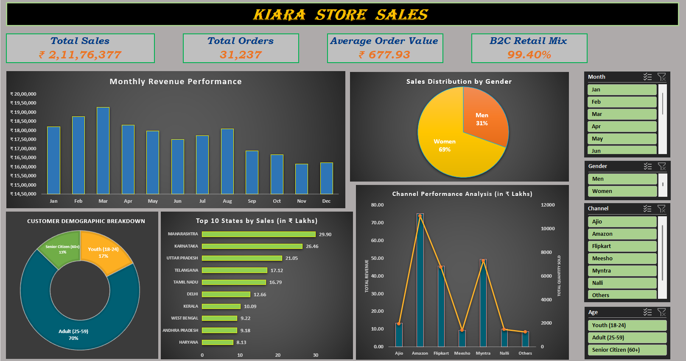

# Kiara Store Sales Dashboard (Excel)

## 📌 Project Overview
An interactive Excel dashboard that transforms raw e-commerce transaction data into actionable retail insights to track revenue, demographics and channel performance.

## 📊 Business Key Metrics (KPIs)
* **Total Sales:** ₹2.11 Crore (`₹2,11,76,377`)
* **Total Orders:** `31,237`
* **Average Order Value (AOV):** `₹677.93`
* **B2C Retail Mix:** `99.40%`

## 🔍 Top 3 Data Insights
* **Target Audience:** Women drive **69% of overall sales**, with the **Adult age group (25-59)** making up 70% of the customer base.
* **Top Region:** **Maharashtra** is the leading state, generating **₹29.90 Lakhs** in revenue.
* **Best Channel:** **Amazon** is the dominant storefront platform, driving the highest total revenue and volume (over 11,000 units sold).

## 🛠️ Technical Excel Features Implemented
* **Data Cleaning & Transformation:** Handled missing values, formatted currency attributes (INR standard) and structured granular fields for clean parsing.
* **Advanced Pivot Tables:** Used to aggregate multi-variable metrics across categories, geographic vectors, and time frameworks.
* **Interactive Slicers:** Integrated structural filters for **Month, Gender, Channel and Age** categories to allow seamless, multi-dimensional dynamic dashboard drilling.
* **Data Visualization & Design:** Built custom combined dual-axis charts (Revenue vs. Quantity Sold), ring donut charts for population segmentation, clean bar distributions and a cohesive executive dark UI theme.

## 📁 Repository Structure
* `Kiara Store Sales Dashboard.xlsx` (Includes both the interactive **Dashboard** and the **Raw Data** sheets).
* `kiara-store-sales-dashboard.png` (Dashboard preview image).
